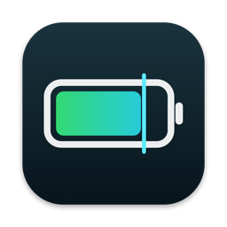
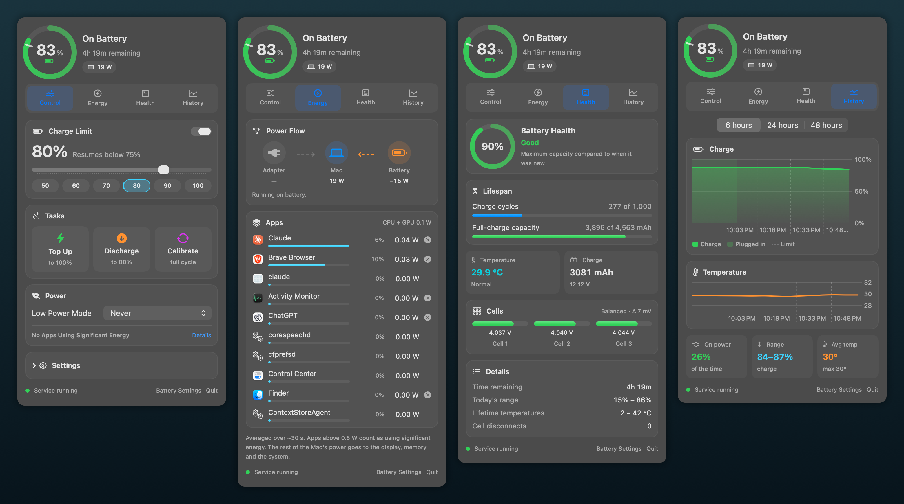

<p align="center">
  
</p>

<h1 align="center">Dynamo</h1>

<p align="center">
  <b>Battery care for Apple Silicon Macs.</b><br>
  Charge limiting, calibration, battery health and energy monitoring, right in your menu bar.<br>
  Free and open source.
</p>

<p align="center">
  <a href="https://github.com/arshdwani/Dynamo/actions/workflows/build.yml"></a>
  
  
  
  <a href="LICENSE"></a>
</p>

<p align="center">
  
</p>

## Why

Lithium-ion batteries wear fastest when they sit at 100% and when they get hot, which is
exactly what happens to a MacBook that lives on its charger. Holding the charge at around
80% noticeably slows that wear. macOS can only *delay* the last 20% ("Optimized Battery
Charging"). Dynamo lets you set a hard limit, and it shows you what is actually happening
to your battery and power.

It's a free alternative to paid battery tools, built as a small native Swift app with no
dependencies, no telemetry and no account.

## Features

**Charging control**
- **Charge limit** from 20 to 100%, with one-tap presets
- **Sailing range**, so it doesn't top up after every 1% drop
- **Top Up** to 100% once (before a trip), then back to your limit
- **Discharge** down to the limit while staying plugged in
- **Calibration**: 15% → 100% → rest 1 hour → back to the limit, with live progress
- **Heat protection**: pauses charging when the battery runs hot
- **Sleep-aware**: stays awake while charging to the limit, and stops charging before sleep so it never overshoots
- **MagSafe light** turns green while the battery is held at the limit
- **Low Power Mode**: Never / Always / Only on Battery / Only on Power Adapter
- Notifications when long tasks finish

**Insight**
- Live **power flow**: adapter → Mac ↔ battery, in watts
- **Apps using significant energy**, ranked by real power use, with one-click quit
- **Battery health** as macOS reports it, plus cycles, full-charge capacity, temperature
  and per-cell voltages and balance
- **History**: 6/24/48-hour charge and temperature charts, with plugged-in periods shaded

**Menu bar**
- A battery icon drawn to the exact level, with charging, plugged-in and discharging
  states. It can replace the system battery icon.
- If your menu bar is crowded and the icon ends up behind the notch, Dynamo opens as a
  window instead.

## Requirements

- A Mac with Apple Silicon (M1 or later)
- macOS 13 Ventura or later (developed on macOS 26)
- Xcode Command Line Tools: `xcode-select --install`

## Install

```bash
git clone https://github.com/arshdwani/Dynamo.git
cd Dynamo
./install.sh
```

The installer builds from source, asks for your password once (the charging service needs
root), and puts **Dynamo** in your menu bar. Re-run it any time to upgrade; your settings
are kept.

Recommended afterwards:
- **System Settings → Battery → Optimized Battery Charging**: turn it off so macOS doesn't
  interfere.
- **System Settings → Menu Bar → Battery**: hide the system icon; Dynamo replaces it.
- Don't run another charge limiter (AlDente, batt, …) at the same time. They would fight
  over the same controls.

## Uninstall

```bash
./uninstall.sh
```

This removes everything and hands charging back to macOS.

## Command line

The installer also adds a `dynamo` command:

```bash
dynamo status              # battery, health and charging state
dynamo limit 80            # set the charge limit
dynamo topup               # charge to 100% once   (dynamo topup stop)
dynamo discharge           # drain to the limit     (dynamo discharge stop)
dynamo calibrate           # run a calibration     (dynamo calibrate stop)
dynamo heat on 35          # pause charging above 35 °C
dynamo lowpower battery    # Low Power Mode only on battery
dynamo off                 # let macOS manage charging again
```

## How it works

Dynamo has two parts:

- **`dynamo daemon`**, a small root service run by launchd. Every 5 seconds it reads the
  battery and sets the Mac's SMC charging controls: `CHTE` (charging on/off), `CHIE`
  (adapter on/off, for discharging) and `ACLC` (MagSafe LED). On older firmware it falls
  back to `CH0B`/`CH0C` and `CH0I`. When the service stops, it always turns charging back on.
- **Dynamo.app**, the SwiftUI menu bar app. It reads the battery directly and changes
  settings through `/Library/Application Support/Dynamo/config.json`.

The charging rules live in one pure function, [`Sources/Shared/Policy.swift`](Sources/Shared/Policy.swift),
covered by tests that don't need a real battery.

> [!NOTE]
> Apple doesn't document the SMC charging keys. They've been stable across Apple Silicon
> generations, and Dynamo always re-enables charging when it stops, but use it at your own
> risk.

## Development

```bash
./build.sh                         # build into build/
./build.sh test                    # build and run the policy tests
./build.sh snapshot                # render every tab to build/snapshots/ (light + dark)
swift Tools/make-icon.swift        # regenerate the app icon
swift Tools/make-readme-images.swift
```

Issues and pull requests are welcome.

## Credits

The SMC key values for Apple Silicon were mapped by the open-source community,
especially [actuallymentor/battery](https://github.com/actuallymentor/battery).

## License

[MIT](LICENSE) © 2026 Arshd Wani
